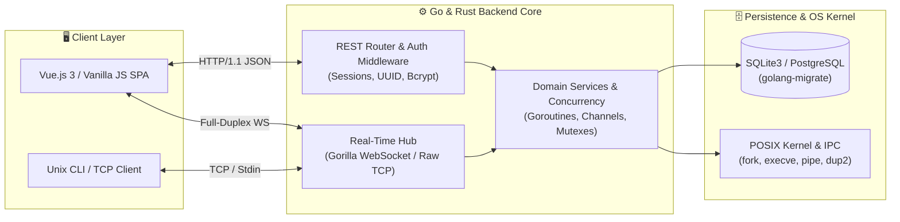

<div align="center">

# 👋 Hi, I'm Aymane Saadane

<!-- Animated Typing SVG -->
<a href="https://asaadane.netlify.app/">
  
</a>

📍 **Mohammedia, Morocco** &nbsp;|&nbsp; 🌍 **Open to Remote & Relocation (Internships / Junior Software Engineer Roles)**

<br/>

<!-- Primary Action Buttons -->
<p align="center">
  <a href="https://asaadane.netlify.app/">
    
  </a>&nbsp;
  <a href="https://linkedin.com/in/asaadane">
    
  </a>&nbsp;
  <a href="mailto:asaadane@proton.me">
    
  </a>&nbsp;
  <a href="https://asaadane.netlify.app/resume/Aymane_Saadane_Resume_ENG.pdf">
    
  </a>&nbsp;
  <a href="https://github.com/shifuuu31">
    
  </a>
</p>

<!-- Quick Identity Pills -->
<p align="center">
  
  
  
  
  
</p>

</div>

---

## 👨‍💻 About Me

I am a **Junior Full-Stack Developer** with a strong **backend orientation** and a deep interest in **systems programming**. My foundation was forged through two rigorous, project-based peer-learning institutions: low-level C, algorithms, and Unix kernel interfaces at **1337 Coding School (42 Network)**, followed by full-stack and real-time software architecture at **Zone01 Oujda (01Talent)**.

My primary language is **Go**, which I use to build clean, maintainable RESTful APIs, full-duplex WebSocket servers, raw TCP network services, and relational database layers. In parallel, I write **Rust and C** to explore operating system internals, process management (`fork`/`execve`), inter-process communication (IPC), and thread synchronization.

```go
package main

type DeveloperProfile struct {
    Name         string
    Role         string
    Location     string
    PrimaryStack []string
    SystemsStack []string
    CoreFocus    []string
}

func Aymane() DeveloperProfile {
    return DeveloperProfile{
        Name:         "Aymane Saadane (@shifuuu31)",
        Role:         "Backend-Oriented Full-Stack Developer",
        Location:     "Morocco (Open to Remote & Relocation)",
        PrimaryStack: []string{"Go 1.23+", "SQLite3", "PostgreSQL", "Vue.js 3", "Vanilla JS (ES6+)", "Docker"},
        SystemsStack: []string{"Rust (Tokio, Clap)", "C (POSIX, pthreads)", "Linux / Debian", "Bash Scripting"},
        CoreFocus:    []string{"Clean Architecture", "REST & WebSockets", "Unix Internals & IPC", "Concurrency"},
    }
}
```

---

## 🧰 Developer Toolbox & Technical Stack

<div align="center">

<!-- Theme-Adaptive Skillicons Strip -->
<picture>
  <source media="(prefers-color-scheme: dark)" srcset="https://skillicons.dev/icons?i=go,rust,c,java,js,ts,py,bash,postgres,sqlite,mysql,mongodb,supabase,vue,react,nextjs,tailwind,html,css,linux,debian,docker,git,github,vscode,neovim,vim,postman,maven,netlify&perline=10&theme=dark" />
  <source media="(prefers-color-scheme: light)" srcset="https://skillicons.dev/icons?i=go,rust,c,java,js,ts,py,bash,postgres,sqlite,mysql,mongodb,supabase,vue,react,nextjs,tailwind,html,css,linux,debian,docker,git,github,vscode,neovim,vim,postman,maven,netlify&perline=10&theme=light" />
  
</picture>

</div>

<br/>

<table align="center">
  <tr>
    <td align="center" width="33%" valign="top">
      <h3>⚙️ Core & Systems Languages</h3>
      <p align="center">
        &nbsp;&nbsp;
        &nbsp;&nbsp;
        &nbsp;&nbsp;
        &nbsp;&nbsp;
        &nbsp;&nbsp;
        &nbsp;&nbsp;
        &nbsp;&nbsp;
        
      </p>
      <p align="center">
        
        
        
        
        
        
      </p>
    </td>
    <td align="center" width="33%" valign="top">
      <h3>🔌 Backend, APIs & Real-Time</h3>
      <p align="center">
        &nbsp;&nbsp;
        &nbsp;&nbsp;
        &nbsp;&nbsp;
        &nbsp;&nbsp;
        
      </p>
      <p align="center">
        
        
        
        
        
      </p>
    </td>
    <td align="center" width="33%" valign="top">
      <h3>🗄️ Databases & Storage</h3>
      <p align="center">
        &nbsp;&nbsp;
        &nbsp;&nbsp;
        &nbsp;&nbsp;
        &nbsp;&nbsp;
        &nbsp;&nbsp;
        
      </p>
      <p align="center">
        
        
        
        
        
      </p>
    </td>
  </tr>
  <tr>
    <td align="center" width="33%" valign="top">
      <h3>🐧 Linux, Systems & Low-Level</h3>
      <p align="center">
        &nbsp;&nbsp;
        &nbsp;&nbsp;
        &nbsp;&nbsp;
        
      </p>
      <p align="center">
        
        
        
        
      </p>
    </td>
    <td align="center" width="33%" valign="top">
      <h3>🎨 Frontend & Web UI</h3>
      <p align="center">
        &nbsp;&nbsp;
        &nbsp;&nbsp;
        &nbsp;&nbsp;
        &nbsp;&nbsp;
        &nbsp;&nbsp;
        
      </p>
      <p align="center">
        
        
        
        
      </p>
    </td>
    <td align="center" width="33%" valign="top">
      <h3>🛠️ DevOps, IDEs & Toolbox</h3>
      <p align="center">
        &nbsp;&nbsp;
        &nbsp;&nbsp;
        &nbsp;&nbsp;
        &nbsp;&nbsp;
        &nbsp;&nbsp;
        &nbsp;&nbsp;
        &nbsp;&nbsp;
        
      </p>
      <p align="center">
        
        
        
        
      </p>
    </td>
  </tr>
</table>

---

## 🏗️ Engineering Architecture & Workflow



---

## 🚀 Featured Engineering Projects

### 1. 🌐 Facebook-like Social Network
<p>
  
  
  
  
  
  
  
</p>

> **Full-stack social networking platform with real-time messaging, group collaboration, and a clean-architecture Go backend containerized with Docker Compose.**

- **Clean Backend Architecture (`pkg/handlers`, `pkg/models`, `pkg/db`, `pkg/wsServer`):** Modular Go 1.23 server utilizing `golang-migrate/v4` for versioned SQLite schema migrations, `satori/go.uuid` for session tokens, and `golang.org/x/crypto` for bcrypt password hashing.
- **Real-Time WebSocket Engine (`gorilla/websocket`):** Full-duplex messaging hub supporting 1-to-1 private chat, multi-user group channels, live online/offline presence tracking, and instant real-time notification broadcasting.
- **Complete Social Graph & Privacy Controls:** Supports public/private user profiles, follow request workflows, posts with visibility tiers (public, followers, custom selection), comments, image uploads, groups, and group event RSVP scheduling.
- **Containerized Deployment:** Orchestrated via `docker-compose.yml` isolating the Go API/WebSocket server (`:8001`) and the Vue 3 SPA (`:8080`).

---

### 2. 💬 Real-Time Forum & EchoHub Community
<p>
  
  
  
  
  
  
</p>

> **Single-page community discussion platforms built with Go, SQLite, and Vanilla JavaScript, featuring real-time private chat, live user presence, and OpenAPI documentation.**

- **Frameworkless SPA Architecture:** Engineered a dynamic single-page frontend using pure Vanilla JavaScript (`app.js`), managing client-side view routing, asynchronous `fetch` requests, and live DOM updates without frontend framework overhead.
- **WebSocket Hub (`ws/hub.go`):** Dedicated connection hub tracking active user sessions, broadcasting real-time online status lists, and routing instant private messages with conversation history pagination.
- **Backend & Database Engineering:** Structured Go backend (`cmd/`, `internal/database`, `internal/models`) with normalized SQLite tables for multi-category posts, nested comments, and like/dislike counters, documented with `swaggo/http-swagger`.

---

### 3. 🐚 0-Shell & Unix Systems Tooling (`0-Shell`, `rusty_wget`, `my-ls`, `net-cat`)
<p>
  
  
  
  
  
</p>

> **Suite of custom Unix command-line utilities, shell interpreters, and raw TCP servers built from scratch in Rust and Go.**

- **`0-Shell` (Minimal Bash Clone in Rust):** Custom Unix shell supporting lexical command parsing, environment variable expansion (`$VAR`), process spawning (`fork`/`execve`/`waitpid`), multi-stage pipelines (`|`), file I/O redirection (`<`, `>`, `>>`), POSIX signal handling (`SIGINT`, `SIGQUIT`), and core builtins (`cd`, `env`, `exit`).
- **`rusty_wget` (Async Wget Clone in Rust):** Reimplementation of GNU `wget` using `tokio` async runtime and `clap` derive macros, supporting HTTP/HTTPS file downloads, progress indicators, rate limiting, and recursive offline site mirroring.
- **`net-cat` (TCP NetCat Chat in Go):** Concurrent TCP chat server (`TCPChat`) recreating `nc` functionality over raw TCP sockets (`net.Listen`), supporting up to 10 simultaneous clients, mutex-guarded room broadcasting, and timestamped connection logging.
- **`my-ls` (Unix `ls` Clone in Go):** Low-level filesystem inspector recreating `ls` flags (`-l`, `-R`, `-a`, `-r`, `-t`) with custom sorting, permission bit formatting, symlink resolution, and recursive directory traversal without external libraries.

---

### 4. ⚙️ Pipex — Unix Multi-Pipeline & IPC Engine
<p>
  
  
  
  <a href="https://github.com/shifuuu31/Pipex_42-cursus">
    
  </a>
</p>

> **Systems-level C implementation reproducing POSIX shell pipeline execution (`< infile cmd1 | cmd2 > outfile`) via inter-process communication.**

- **Inter-Process Communication (IPC):** Creates and coordinates unidirectional anonymous Unix pipes (`pipe()`) between concurrent child processes spawned via `fork()`.
- **Descriptor Redirection & Execution:** Maps standard input/output streams using `dup2()`, resolves binary paths dynamically from `envp` (`PATH`), validates execution permissions with `access()`, and replaces process images via `execve()`.
- **Strict Resource Hygiene:** Ensures deterministic closure of unused pipe descriptors across parent and child processes, preventing deadlocks, zombie processes (`waitpid`), and memory leaks (verified with Valgrind).
- 🔗 **Source Code:** [**`github.com/shifuuu31/Pipex_42-cursus`**](https://github.com/shifuuu31/Pipex_42-cursus)

---

## 📂 Public 42 Network & Systems Repositories

All 42 Network curriculum repositories below are **publicly accessible** on my GitHub profile with detailed technical documentation:

| Repository | Language & Stack | Engineering Implementation & Key Concepts |
| :--- | :--- | :--- |
| 📦 [**`Pipex_42-cursus`**](https://github.com/shifuuu31/Pipex_42-cursus) |  `POSIX IPC` | Unix process pipeline simulator using `pipe()`, `fork()`, `dup2()`, `waitpid()`, and `execve()`. |
| 🛡️ [**`Born2beroot_42-cursus`**](https://github.com/shifuuu31/Born2beroot_42-cursus) |   | Hardened Linux server: encrypted LVM partitions, SSH port/root hardening, UFW firewall, strict `sudo` policies, PAM password rules, and a custom `cron` system telemetry script (`monitoring.sh`). |
| 🎮 [**`So_Long_42-cursus`**](https://github.com/shifuuu31/So_Long_42-cursus) |  `MinilibX (X11)` | 2D top-down tile game engine in C featuring `.ber` map parsing, **BFS flood-fill path validation**, X11 window rendering, keyboard event hooks, and leak-free texture teardown. |
| 🔢 [**`Push_swap_42-cursus`**](https://github.com/shifuuu31/Push_swap_42-cursus) |  `Algorithms` | Dual-stack (`stack_a`, `stack_b`) integer sorting engine optimizing push, swap, and rotate instructions to sort 100 and 500 random integers within minimal operation thresholds. |
| 🧵 **`Philosophers_42-cursus`** |  `pthreads` | Dining Philosophers concurrency simulator solving resource contention, race conditions, and deadlocks using POSIX threads (`pthread_create`) and mutex locks (`pthread_mutex_lock`). |
| 📚 [**`Libft_42-cursus`**](https://github.com/shifuuu31/Libft_42-cursus) |  `Data Structures` | Custom reimplementation of standard `libc` memory, string, and linked-list manipulation functions, alongside [**`Ft_printf`**](https://github.com/shifuuu31/Ft_printf_42-cursus) (variadic formatting) and [**`Get_next_line`**](https://github.com/shifuuu31/Get_next_line_42-cursus) (buffered FD line reader). |

---

## 🔄 Active & In-Progress Explorations

- 🏗️ **`01Blog`** (`Java`, `Spring Boot`, `Angular`) — Full-stack blogging and content platform exploring Spring Security, JWT authentication, RESTful service layers, user follows, notifications, and content moderation.
- 🌐 **`Local Server`** (`Java`) — Custom HTTP/1.1 server implementation exploring non-blocking I/O (`java.nio`), raw socket lifecycle management, custom routing tables, session handling, and multipart file uploads.
- 🚦 **Traffic Simulation Systems (`road_intersection` in Rust & `JrafficV2` in Java 17)** — Real-time cross-intersection traffic simulators built with Rust (`macroquad`) and JavaFX, modeling lane queues, traffic light state machines, and vehicle collision avoidance.
- 📊 **GraphQL Analytics Dashboard (`graphql`)** — Interactive developer telemetry dashboard querying Zone01's GraphQL API with JWT authentication and dynamic SVG data visualizations.

---

## 📈 GitHub Activity & Analytics

<div align="center">

<p align="center">
  
  
</p>

<p align="center">
  
</p>

</div>

---

## 📫 Connect With Me

I am actively seeking **Internships and Junior Software Engineering roles (Backend / Full-Stack)** — open to **Remote** and **Relocation** opportunities.

<div align="center">

| Platform | Direct Link | Purpose |
| :--- | :--- | :--- |
| 🌐 **Personal Portfolio** | [**asaadane.netlify.app**](https://asaadane.netlify.app/) | Interactive project showcase, education timeline & downloadable CV (EN / FR) |
| 💼 **LinkedIn** | [**linkedin.com/in/asaadane**](https://linkedin.com/in/asaadane) | Professional network, background & direct messaging |
| 💻 **GitHub** | [**github.com/shifuuu31**](https://github.com/shifuuu31) | Public source code, C/Unix systems repos & commit history |
| 📧 **Email** | [**asaadane@proton.me**](mailto:asaadane@proton.me) | Direct inquiries regarding internships, junior roles & technical collaboration |

<br/>

> *“Learn deeply. Build simply. Understand what runs underneath.”*

</div>
